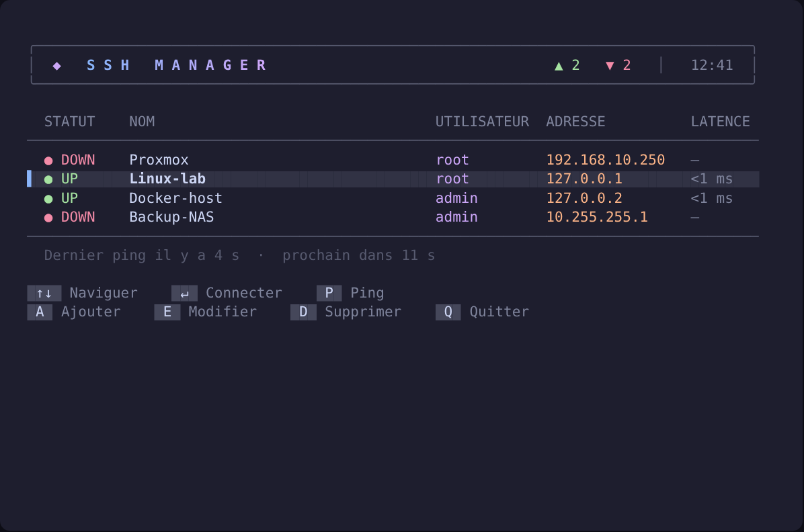

<div align="center">

# ◆ SSH Manager

**Un gestionnaire de connexions SSH élégant pour le terminal Windows.**
**An elegant SSH connection manager for the Windows terminal.**


[🇫🇷 Français](#-français) · [🇬🇧 English](#-english)



</div>

---

## 🇫🇷 Français

### Présentation

SSH Manager est une interface en ligne de commande pour enregistrer vos machines (VM, serveurs, Proxmox…) et vous y connecter en SSH en un seul appui sur une touche. Il n'y a rien à installer : tout repose sur PowerShell et le client OpenSSH déjà fournis avec Windows.

### Fonctionnalités

- **Navigation au clavier** : choisissez une machine avec les flèches et appuyez sur Entrée pour vous connecter.
- **État en direct** : un ping en arrière-plan affiche si chaque machine est UP ou DOWN, avec sa latence, et se rafraîchit automatiquement.
- **Une fenêtre par session** : chaque connexion s'ouvre dans une nouvelle fenêtre (ou un nouvel onglet) de Windows Terminal, nommée d'après la machine.
- **Gestion intégrée** : ajoutez, modifiez ou supprimez une machine depuis l'interface, avec vérification des saisies.
- **Utilisateur par machine** : chaque entrée a son propre compte (`root`, `admin`…).
- **Sécurité** : le script ne stocke aucun mot de passe. Il est compatible avec les clés SSH, y compris les clés physiques FIDO2.

### Prérequis

| Élément | Détail |
|---|---|
| Système | Windows 10 ou 11 |
| PowerShell | 5.1 ou plus récent (inclus dans Windows) |
| Client OpenSSH | Inclus dans Windows. Sinon : *Paramètres › Applications › Fonctionnalités facultatives › Client OpenSSH* |
| Windows Terminal | Recommandé pour un affichage optimal (installé par défaut sur Windows 11) |

### Installation

1. Téléchargez le dépôt (**Code › Download ZIP**) ou clonez-le :
   ```powershell
   git clone https://github.com/<votre-compte>/<votre-depot>.git
   ```
2. Placez `script.bat` et `ssh-manager.ps1` dans **le même dossier**.
3. Double-cliquez sur **`script.bat`**.

Au premier lancement, un fichier `vms.txt` est créé à côté du script pour stocker vos machines.

> **Note :** lancez toujours le `.bat`, pas le `.ps1`. Le `.bat` ouvre l'interface dans Windows Terminal et évite les blocages liés à la politique d'exécution de PowerShell.

### Utilisation

| Touche | Action |
|---|---|
| `↑` `↓` | Sélectionner une machine |
| `Entrée` | Se connecter à la machine sélectionnée |
| `A` | Ajouter une machine |
| `E` | Modifier la machine sélectionnée (nom, IP, utilisateur) |
| `D` | Supprimer la machine sélectionnée |
| `P` | Relancer le ping de toutes les machines |
| `Q` / `Échap` | Quitter |

Dans les formulaires, `Entrée` passe au champ suivant puis valide, `↑` `↓` changent de champ et `Échap` annule.

### Configuration

Les réglages se trouvent en haut de `ssh-manager.ps1` :

```powershell
$Config = @{
    UserDefaut  = 'root'      # Utilisateur proposé par défaut
    Ouverture   = 'fenetre'   # 'fenetre' ou 'onglet'
    PingTimeout = 1000        # Délai max d'un ping (ms)
    AutoPing    = 15          # Ping automatique toutes les X secondes (0 = désactivé)
}
```

### Format du fichier `vms.txt`

Une machine par ligne, au format `Nom|Adresse|Utilisateur` :

```text
Proxmox|192.168.10.250|root
Linux-lab|192.168.10.92|admin
```

Ce fichier contient les adresses de votre infrastructure. Pensez à l'ajouter à votre `.gitignore` si le dépôt est public.

### Raccourci clavier (optionnel)

Pour ouvrir le gestionnaire avec `Ctrl + Alt + T` depuis n'importe quelle fenêtre, installez [AutoHotkey v2](https://www.autohotkey.com) et utilisez le fichier `ssh_raccourci.ahk` (adaptez le chemin du script à l'intérieur). Placez-le dans le dossier `shell:startup` pour qu'il s'active au démarrage de Windows.

### Sécurité : connexion par clé SSH

Il est recommandé de remplacer les mots de passe par une clé SSH. Avec une **clé physique FIDO2** (YubiKey, Key-ID…), la clé privée ne quitte jamais le périphérique, et chaque connexion exige un contact physique, voire un code PIN :

```powershell
# 1. Créer la clé (toucher la clé de sécurité quand Windows le demande)
ssh-keygen -t ed25519-sk -O verify-required
#    Si la clé ne gère pas ed25519, utilisez : -t ecdsa-sk

# 2. Copier la clé publique sur une machine
type $env:USERPROFILE\.ssh\id_ed25519_sk.pub | ssh root@192.168.10.250 "mkdir -p ~/.ssh && cat >> ~/.ssh/authorized_keys && chmod 700 ~/.ssh && chmod 600 ~/.ssh/authorized_keys"
```

> ⚠️ Avant de désactiver la connexion par mot de passe sur vos serveurs (`PasswordAuthentication no`), prévoyez un accès de secours : console de l'hyperviseur ou seconde clé.

---

## 🇬🇧 English

### Overview

SSH Manager is a command-line interface to store your machines (VMs, servers, Proxmox…) and connect to them over SSH with a single keystroke. Nothing to install: it only relies on PowerShell and the OpenSSH client that already ship with Windows.

### Features

- **Keyboard navigation**: pick a machine with the arrow keys and press Enter to connect.
- **Live status**: a background ping shows whether each machine is UP or DOWN, with its latency, and refreshes automatically.
- **One window per session**: each connection opens in a new Windows Terminal window (or tab), named after the machine.
- **Built-in management**: add, edit or delete machines from the interface, with input validation.
- **Per-machine user**: each entry has its own account (`root`, `admin`…).
- **Security**: the script never stores passwords. It works with SSH keys, including FIDO2 hardware keys.

### Requirements

| Item | Details |
|---|---|
| OS | Windows 10 or 11 |
| PowerShell | 5.1 or later (built into Windows) |
| OpenSSH client | Built into Windows. Otherwise: *Settings › Apps › Optional features › OpenSSH Client* |
| Windows Terminal | Recommended for the best rendering (installed by default on Windows 11) |

### Installation

1. Download the repository (**Code › Download ZIP**) or clone it:
   ```powershell
   git clone https://github.com/<your-account>/<your-repo>.git
   ```
2. Keep `script.bat` and `ssh-manager.ps1` in **the same folder**.
3. Double-click **`script.bat`**.

On first launch, a `vms.txt` file is created next to the script to store your machines.

> **Note:** always launch the `.bat`, not the `.ps1`. The `.bat` opens the interface in Windows Terminal and avoids PowerShell execution-policy issues.

### Usage

| Key | Action |
|---|---|
| `↑` `↓` | Select a machine |
| `Enter` | Connect to the selected machine |
| `A` | Add a machine |
| `E` | Edit the selected machine (name, IP, user) |
| `D` | Delete the selected machine |
| `P` | Ping all machines again |
| `Q` / `Esc` | Quit |

In forms, `Enter` moves to the next field then submits, `↑` `↓` switch fields and `Esc` cancels.

### Configuration

Settings are at the top of `ssh-manager.ps1`:

```powershell
$Config = @{
    UserDefaut  = 'root'      # Default user suggested for new machines
    Ouverture   = 'fenetre'   # 'fenetre' (new window) or 'onglet' (new tab)
    PingTimeout = 1000        # Max ping wait (ms)
    AutoPing    = 15          # Automatic ping every X seconds (0 = disabled)
}
```

### `vms.txt` format

One machine per line, as `Name|Address|User`:

```text
Proxmox|192.168.10.250|root
Linux-lab|192.168.10.92|admin
```

This file contains your infrastructure's addresses. Consider adding it to your `.gitignore` if the repository is public.

### Keyboard shortcut (optional)

To open the manager with `Ctrl + Alt + T` from any window, install [AutoHotkey v2](https://www.autohotkey.com) and use the `ssh_raccourci.ahk` file (update the script path inside it). Put it in the `shell:startup` folder so it starts with Windows.

### Security: SSH key authentication

Replacing passwords with an SSH key is recommended. With a **FIDO2 hardware key** (YubiKey, Key-ID…), the private key never leaves the device, and every connection requires a physical touch, and optionally a PIN:

```powershell
# 1. Create the key (touch the security key when Windows asks)
ssh-keygen -t ed25519-sk -O verify-required
#    If your key doesn't support ed25519, use: -t ecdsa-sk

# 2. Copy the public key to a machine
type $env:USERPROFILE\.ssh\id_ed25519_sk.pub | ssh root@192.168.10.250 "mkdir -p ~/.ssh && cat >> ~/.ssh/authorized_keys && chmod 700 ~/.ssh && chmod 600 ~/.ssh/authorized_keys"
```

> ⚠️ Before disabling password login on your servers (`PasswordAuthentication no`), make sure you have a fallback: hypervisor console or a second key.
